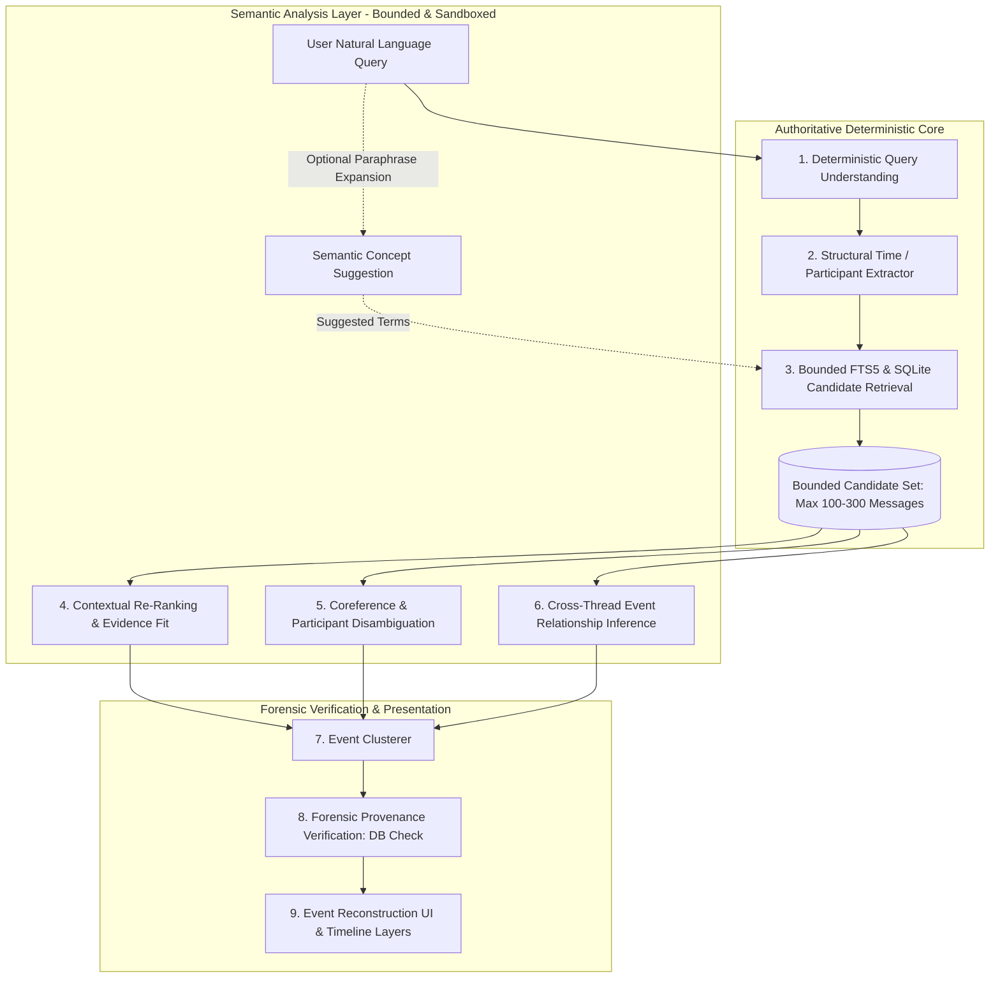

# Step 8 — Semantic Intelligence Architecture Review
**Document Version:** 1.0.0  
**Status:** Architectural Review & Strategy  
**Baseline Milestone:** `b038557c59ce943b156aa0fe3cc5d136da758feb` (Step 7 Complete: 100% Precision, 100% Recall, 0 FP, 0 FN)

---

## 1. What Deterministic Threadline Already Handles Well

Through Steps 1–7, Threadline established an authoritative, high-speed, zero-hallucination deterministic core. Specifically, the deterministic architecture excels at:

1. **Exact Forensic Preservation & Provenance:**
   - Source messages from SQLite are untouched and immutable.
   - Message IDs, conversation IDs, participant handles, timestamps (UTC), directions, and platforms are never altered or hallucinated.
   - Every returned result is explicitly backed by SQLite records.

2. **Structural Temporal Operations:**
   - Precise UTC calendar filters (year, month, exact day, date ranges).
   - Relative event anchor offsets ("after the meeting", "the next day after the concert", "that week", "during", "before").
   - Pure temporal queries directly bypassing full-text keyword requirements without degrading precision.

3. **Known Verb Inflections:**
   - Explicit, deterministic morphological normalization for common action verbs (`call/called/calling`, `pick/picked/picking`, `decide/decided`, `cancel/canceled`, `meet/met`, `go/went/going`, `plan/planned`).
   - Whole-word matching prevents false-positive overmatching against unrelated words sharing crude stems (e.g. `calligraphy` does not match `call`).

4. **Curated High-Value Concept Dictionaries:**
   - High-precision matching for known operational categories (e.g. `visitation`, `transportation`, `concert`, `argument`, `camping`, `shopping`, `refused`).
   - Phrasal verb handling with embedded pronouns (e.g. `pick me up`, `picking her up`).

5. **Multi-Signal Event Clustering & Contextual Expansion:**
   - Multi-signal evidence grouping combining shared concepts, query keywords, participant relevance, and temporal decay curves.
   - Bounded adjacent sequence recovery ($\pm 60$ minutes in the same thread for confirmations and follow-ups).
   - Clean partition of distinct temporal events (e.g. May jazz concert vs October rock concert).

---

## 2. What Semantic Intelligence Could Add

While deterministic logic achieved 100% on the benchmark corpus, scaling to real-world natural-language communication across hundreds of thousands of messages introduces hard linguistic ceilings:

1. **Open-Ended Paraphrasing / Semantic Equivalence:**
   - Real conversational coordination rarely uses standardized words.
   - *Example Query:* "Find where we figured out how everyone was getting there."
   - *Unseen messages:* "I'll take the commuter line.", "Can someone grab Sarah?", "Got room for two in the back.", "Taking the red line from South Station."
   - A static dictionary cannot enumerate every transportation verb or urban transit vernacular without becoming an unmaintainable dictionary of thousands of terms.

2. **Coreference & Pronominal Ambiguity:**
   - Natural queries frequently refer to individuals by pronoun: "Find the conversation where **she** called me after the meeting" or "When did **they** say the payment was due?"
   - In deterministic logic, "she" is treated as an empty filter or filler word. If multiple female contacts or threads exist, deterministic logic cannot inspect contextual metadata (e.g., meeting invite attendees, conversation participants) to disambiguate the referent.

3. **Unseen Slang, Dialects, and Evolving Vernacular:**
   - Slang varies by generation, platform, and geography (e.g., "bread" / "loot" / "bands" / "racks" for money; "whip" / "ride" / "uber" for cars; "kicking it" / "pulling up" for meeting).
   - Deterministic expansion requires manual entry of each term; semantic intelligence recognizes vernacular from contextual semantics.

4. **Implicit / Elliptical Event Linkages Across Threads:**
   - *Thread A:* "Are we still doing Saturday?"
   - *Thread B:* "Yeah, I'll pick you up at 7."
   - *Thread C:* "Tickets are in my email."
   - These three messages have zero shared keywords or explicit concept tokens, yet a human investigator immediately recognizes them as coordinating a single Saturday outing. Semantic reasoning can evaluate whether cross-thread messages represent co-referent sub-events of a single activity.

5. **Discourse Role & Speech Act Classification:**
   - Distinguishing a genuine commitment ("I will pick you up at 5") from a conditional suggestion ("I could pick you up if my car starts") or a negated plan ("I can't pick you up anymore").

---

## 3. What Semantic Intelligence Must NOT Be Allowed to Do

To preserve Threadline's core identity as an investigative/forensic tool, the following boundaries are non-negotiable:

| Forbidden AI Action | Forensic / Investigative Justification |
| :--- | :--- |
| **Direct Unbounded DB Retrieval** | An LLM must NEVER run arbitrary SQL or "browse" the database. It cannot act as an unconstrained agent deciding what messages exist. |
| **Synthesizing Source Message Text** | The LLM must NEVER summarize or alter a source message body in the evidentiary record. Reconstructed conversations must only show raw, verbatim messages. |
| **Fabricating Timestamps or Participants** | Timestamps, senders, recipients, platforms, and message IDs must come directly and immutably from SQLite. |
| **Asserting Inferences as Empirical Fact** | Semantic inferences must never be presented as deterministic hits. The UI and API must clearly demarcate what was *matched* vs what was *inferred*. |
| **Probabilistic Coreference Certainty** | The AI must never definitively state "she is Rachel" if there is ambiguity. It must qualify references probabilistically (e.g. "Likely refers to Rachel based on meeting attendee records"). |
| **Silent Event Merging** | The AI must never silently merge two distinct events without showing the explicit causal or contextual link to the user. |

---

## 4. Recommended System Architecture

The authoritative architecture preserves the existing deterministic engine as the **Ground-Truth Retrieval Layer**, inserting the semantic intelligence layer exclusively as a **Bounded Analysis & Expansion Pipeline**:



### Key Architectural Invariant:
**The semantic layer only inspects what the deterministic layer has retrieved (or suggests deterministic search terms for the deterministic layer to retrieve).** It operates exclusively on bounded evidence.

---

## 5. Candidate AI Insertion Points & Evaluation

### Insertion Point A: Query Understanding & Parameter Extraction
- **Role:** Parse unstructured, complex natural queries into structured intents.
- **Input:** Raw query string.
- **Output:**
  ```json
  {
    "detectedParticipants": ["unknown_female_reference"],
    "actionStems": ["call", "phone"],
    "temporalRelationship": "after",
    "temporalAnchorDescription": "the meeting",
    "topicDomain": "follow-up discussion"
  }
  ```
- **Forensic Safety:** Very High. The LLM produces a structured search intent; it retrieves nothing itself.
- **Verdict:** **Recommended**.

### Insertion Point B: Semantic Candidate Expansion (Controlled Query Expansion)
- **Role:** Suggest additional vocabulary for deterministic FTS5 retrieval when queries use abstract phrases.
- **Example:** "figuring out transportation" $\rightarrow$ suggests `["subway", "train", "cab", "rideshare", "carpool", "driving"]`.
- **Constraint:** The suggested terms are fed back into the deterministic FTS5 engine with lower weight. Every candidate message is still retrieved by SQLite FTS5.
- **Forensic Safety:** High. All retrieved messages are verifiable FTS5 matches.
- **Verdict:** **Recommended**.

### Insertion Point C: Contextual Candidate Re-Ranking
- **Role:** Re-score the bounded candidate set (e.g., top 100 messages) based on deep semantic fit to the query.
- **Input:** Query text + list of { id, body, sender, timestamp, conversationTitle }.
- **Output:** Semantic relevance score $\in [0.0, 1.0]$ and explanation.
- **Constraint:** Re-ranking can elevate or demote candidates within the retrieved pool, but cannot introduce new candidates from outside the bounded set.
- **Forensic Safety:** High.
- **Verdict:** **Recommended**.

### Insertion Point D: Coreference & Ellipsis Disambiguation
- **Role:** Analyze referents for pronouns ("she", "they", "that one") within the bounded conversation context.
- **Input:** Target message + preceding 5 messages in thread + participant directory.
- **Output:** Referent candidate + confidence level ("Possible" / "Probable" / "Definite") + cited evidence snippet.
- **Forensic Safety:** High, provided the referent is displayed as an *inferred tag* and not an altered sender/recipient header.
- **Verdict:** **Recommended**.

### Insertion Point E: Cross-Thread Implicit Event Linking
- **Role:** Detect whether messages across 3 disparate threads (e.g. "Are we still doing Saturday?", "I'll pick you up at 7", "Tickets are in my email") refer to the same physical event.
- **Input:** Bounded chronological cluster candidates.
- **Output:** Event relationship score + inferred connecting topic.
- **Forensic Safety:** Moderate. Must retain strict temporal proximity bounds ($\le 7$ days) so the AI does not link conversations years apart merely because both discuss "dinner".
- **Verdict:** **Recommended with Guardrails**.

---

## 6. Evidence and Provenance Model

To ensure forensic integrity in legal, corporate, or investigative proceedings, Threadline must maintain a clean separation between **Empirical Evidence** and **Inferred Relationships**:

```
+-------------------------------------------------------------------------+
|                              RESULT OBJECT                              |
+-------------------------------------------------------------------------+
| 1. FORENSIC SOURCE EVIDENCE (100% Deterministic & Authoritative)         |
|    - Message ID: "msg_sarah_04"                                         |
|    - Conversation ID: "conv_sarah_101"                                  |
|    - Exact Source Body: "We decided not to go because of the blizzard." |
|    - Exact UTC Timestamp: 1768482000000 (2026-01-16T11:00:00.000Z)      |
|    - Authoritative Sender / Recipient: "Sarah" -> "Me"                  |
|    - Message Direction: "received"                                      |
|    - Platform: "iMessage"                                               |
|    - SQLite Row Hash / Signature: [Immutable SHA-256]                   |
+-------------------------------------------------------------------------+
| 2. DETERMINISTIC MATCH EVIDENCE                                         |
|    - FTS5 Keyword Match: "decided", "not"                               |
|    - Deterministic Score: 160                                           |
|    - Primary Match Reason: "Keyword match: decided; not"                |
+-------------------------------------------------------------------------+
| 3. SEMANTIC INFERENCE LAYER (Clearly Labeled as Machine Inferred)       |
|    - Semantic Fit Score: 0.94                                           |
|    - Discourse Classification: "Trip Cancellation Statement"           |
|    - Inferred Event Connection: "January Aspen Ski Trip"                |
|    - Inferred Coreference: "we" -> ["Sarah", "Me"] (Confidence: 95%)    |
|    - Inference Provenance: "Derived from preceding message msg_sarah_01"|
+-------------------------------------------------------------------------+
```

---

## 7. Confidence Model: Evidence vs Inference

Threadline will define two orthogonal confidence axes:

### Axis 1: Evidence Confidence (Factuality)
- **Authoritative (100%):** Direct SQLite database record with verified row signature. Source text is unaltered.
- **Deterministic Match:** Direct full-text match, exact calendar date match, or explicit participant link.

### Axis 2: Inference Confidence (Interpretive Quality)
- **High Confidence ($\ge 85\%$):** Multi-signal corroboration. (e.g. Pronoun "she" follows 1 message after "Rachel called", in a 1-on-1 thread with Rachel).
- **Probable ($60\% - 84\%$):** Strong contextual markers, but alternative interpretations exist (e.g., two female participants mentioned in a group chat earlier that day).
- **Possible ($35\% - 59\%$):** Plausible thematic connection without direct corroborating names.
- **Speculative ($< 35\%$):** Rejected by the system; not shown to user.

**Rule:** The UI will visually distinguish empirical facts from inferences using clear metadata tags and indicators (e.g. `[Verified Evidence]` vs `[Inferred Connection: 85% Confidence]`).

---

## 8. Privacy, Security & Deployment Considerations

Because Threadline is designed for sensitive personal communications and law-enforcement investigation contexts, data privacy is paramount:

### Deployment Models:

1. **Local Embedded Model (e.g., ONNX, WebAssembly, or local small model like Gemma-2B / MiniLM):**
   - **Pros:** 100% private, zero network traffic, works fully air-gapped/offline, zero API costs, zero data retention risk, ideal for sensitive law enforcement evidence.
   - **Cons:** Constrained to local GPU/CPU; higher memory footprint on client machine; limited reasoning compared to large frontier models.

2. **Self-Hosted Local Server (e.g., Ollama, vLLM, LocalAI on localhost):**
   - **Pros:** Full privacy, runs on user's workstation or departmental server, supports 8B–14B models (e.g. Llama-3.1-8B, Qwen-2.5-7B).
   - **Cons:** Requires user setup/hardware; requires local inference server process.

3. **External Cloud API (e.g., Google Gemini, Anthropic Claude, OpenAI):**
   - **Pros:** Highest reasoning quality, zero client compute overhead, instant setup.
   - **Cons:** PII leaves the machine; evidence preservation challenges (third-party logging, chain-of-custody compliance); ongoing token cost; requires continuous internet connection.

4. **Recommended Hybrid Architecture: "Privacy-First Tiering"**
   - **Tier 1 (Default / Air-Gapped):** Pure Deterministic Engine (Steps 1–7) + optional local lightweight embedding/cross-encoder (runs 100% locally with zero external network calls).
   - **Tier 2 (User-Opted Local AI):** Local inference via Ollama / local runtime on `localhost:11434`.
   - **Tier 3 (User-Opted Cloud API):** Explicitly configured by user with their own API key, with an explicit privacy warning detailing that message snippets will be transmitted to the chosen provider.

---

## 9. Comparative Tradeoff Matrix

| Dimension | Pure Deterministic (Current) | Local AI (Embedded/Ollama) | Cloud AI API |
| :--- | :--- | :--- | :--- |
| **Precision** | **100.0%** | 92% – 98% | 94% – 99% |
| **Recall on Known Patterns** | **100.0%** | 95% – 100% | 98% – 100% |
| **Recall on Unseen Paraphrasing** | 60% – 75% | 90% – 95% | **95% – 99%** |
| **Speed / Latency** | **< 15 ms** | 100 ms – 1.5 s | 500 ms – 3.0 s |
| **Air-gapped / Offline** | **Yes (100%)** | **Yes (100%)** | No |
| **Zero Data Leakage** | **Guaranteed** | **Guaranteed** | Dependent on terms |
| **Operating Cost** | **$0** | **$0** | Per-token fees |
| **Hardware Requirements** | **Minimal (any CPU)** | Moderate (4GB+ RAM/VRAM)| Minimal |
| **Explainability** | **100% Transparent** | Moderate (Prompt traceable)| Low (Black-box reasoning)|

---

## 10. Future Semantic Benchmark Design (Step 9+)

To benchmark future semantic layers without contaminating the Step 6/7 deterministic baseline, a dedicated **Adversarial Semantic Benchmark** should be constructed with 10 challenging test categories:

1. **Pronoun / Coreference Disambiguation:**
   - "Find where she said she couldn't make it" (multiple female contacts in archive; requires temporal context to resolve).
2. **Abstract Semantic Paraphrases (Zero Lexical Overlap):**
   - "Find discussions about acquiring funds" $\leftrightarrow$ "Need to hit up the ATM before noon."
3. **Transit & Commute Vernacular:**
   - "Find when we talked about how to get to the game" $\leftrightarrow$ "Taking the green line inbound at 6."
4. **Cross-Thread Event Assembly with Weak Lexical Overlap:**
   - 3 separate threads coordinating a single Saturday birthday dinner using only indirect references ("Saturday at 8", "Got the reservation", "Ordered the cake").
5. **Implicit Negations & Retractions:**
   - "Find where the agreement fell through" $\leftrightarrow$ "Deal's off after what happened yesterday."
6. **Time-Drifted Event Sequences:**
   - Planning started in April, resumed in June, executed in July.
7. **Ambiguous Group Discourse:**
   - Decoupling multiple concurrent sub-threads occurring simultaneously in a large group chat.
8. **Distractor Resistance (High Semantic Similarity, Different Event):**
   - "Find the dinner with Bob" when there are 5 different dinners with Bob over two years.
9. **Conditional vs Factual Distinctions:**
   - "Find when we agreed to travel" $\leftrightarrow$ Distinguishing "If I get the bonus, I'll go" from "Booked the flight."
10. **Slang / Idiom Comprehension:**
    - "Spill the tea" (sharing information), "Cold feet" (canceling wedding/plans), "Rain check" (postponing).

---

## 11. Recommended Next Steps

1. **Keep Step 7 in production as the immutable, authoritative core.**
2. **Do NOT replace any deterministic logic with probabilistic models.**
3. **If semantic capabilities are greenlit for Step 9:**
   - Build a pluggable, opt-in **Semantic Re-ranking & Query Expansion Adapter** (`backend/search/semanticAdapter.js`).
   - The adapter will consume the deterministic candidate set, query a local model (e.g. Ollama or local ONNX cross-encoder), and return semantic confidence annotations.
   - Maintain the deterministic engine as the fallback whenever AI is offline, disabled, or unconfigured.

---
*End of Architecture Review.*
